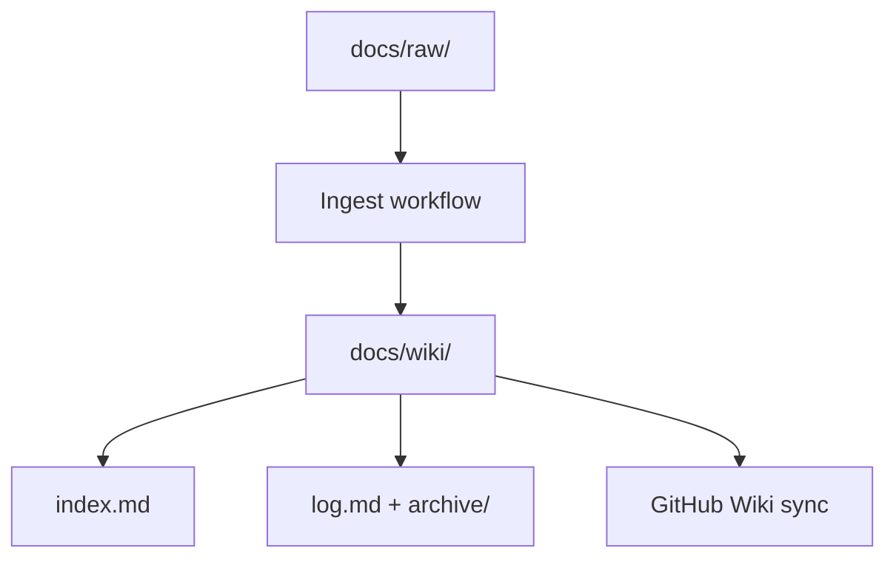

# LLM Wiki

A personal (or team) knowledge base maintained by an AI agent.
Based on [Andrej Karpathy's LLM Wiki pattern](https://github.com/karpathy).

## Purpose

This wiki is a structured, interlinked knowledge base for **your topic**.
The AI maintains the wiki. Humans curate sources, ask questions, and guide the analysis.

Replace this purpose paragraph when you create a repo from the template.

## Folder structure

```
docs/raw/                          -- source documents / tool output
docs/raw/index.md                  -- raw inventory: current/ listing + captures-by-date rollup
docs/raw/current/                  -- living snapshots of present state (refreshed in place)
docs/raw/YYYY/MM/DD/               -- immutable point-in-time captures, filed by capture date
docs/raw/YYYY/MM/DD/README.md      -- manifest of that day's captures
docs/wiki/                         -- markdown pages maintained by the agent
docs/wiki/index.md                 -- table of contents for the entire wiki
docs/wiki/log.md                   -- rolling operation log (7 days full, 90 days indexed)
docs/wiki/archive/log-archive.md   -- index of every archived operation day
docs/wiki/archive/YYYY/MM/YYYY-MM-DD.md -- full prose for every operation on that date
docs/wiki/topics/                  -- one page per major subject area
docs/wiki/concepts/                -- cross-cutting concepts
```

Add more category folders under `docs/wiki/` as needed. **Basenames must be unique** across the
whole tree — GitHub Wiki sync flattens paths (see **GitHub Wiki sync** below).

## Live data capture workflow

Any time a CLI, API, scrape, or export returns **durable facts** you will use to answer a question
or update the wiki, save the raw output to `docs/raw/` before using it. After saving, run the
standard ingest workflow.

### When this rule applies

- Tool output that describes the current or historical state of the domain (configs, inventories,
  metrics exports, documents, transcripts, database dumps you intend to cite)
- Reads triggered while planning or investigating

### When this rule does NOT apply

- Auth / session checks that return no domain facts
- Intermediate lookups used only to resolve an ID for a follow-up call, when the intermediate
  output has nothing worth preserving

### Naming convention

Use lowercase with hyphens: `<source-or-system>-<descriptor>.<ext>`. **No date in the filename** —
the date is carried by the folder (except when the *coverage window* belongs in the name; see below).

First decide which tier the capture belongs to:

**`docs/raw/current/` — living snapshots.** State that is only interesting as "what is true right now":
inventories, configs you expect to re-read next month. Overwrite in place on every refresh so the
cited path never goes stale.

**`docs/raw/YYYY/MM/DD/` — point-in-time captures.** Evidence for a specific investigation, incident,
or migration, where *when it was taken* is part of the fact. Filed under the date of capture and
**immutable once written**.

| Example | Output file |
|---------|-------------|
| Refresh an inventory | `docs/raw/current/inventory-overview.json` |
| Capture during an incident | `docs/raw/2026/08/23/incident-metrics.json` |
| Same resource recaptured earlier that day at 09:10 | `docs/raw/2026/08/23/incident-metrics-0910.json` |
| Data covering a date range, captured on July 9 | `docs/raw/2026/07/09/usage-2026-06-01-2026-07-01.json` |

**Same-day recaptures.** Within one day folder the base filename holds that day's **latest** capture;
earlier captures of the same resource use `-HHMM` suffixes (24-hour local time). Nothing is discarded
and nothing is merged into a multi-capture wrapper file.

Rule of thumb: **the folder is when the capture was taken; the filename retains anything describing
what the capture covers.**

After writing a dated capture, add a row to that day's `docs/raw/YYYY/MM/DD/README.md` (create if
needed). After writing or refreshing a `current/` file, add a row to `docs/raw/index.md` if it is new.

### Ingest requirement

After saving the raw file, run the standard ingest workflow: update relevant `docs/wiki/` pages,
`docs/wiki/index.md`, and record the operation in the log (see **Operation log rotation**).

### Raw file size (~1 MB guideline)

Treat **~1 MB** as a soft cap for any single file written to `docs/raw/`. Large monoliths are hard to
read, slow to ingest, and usually noisy.

**Before writing** — if a command is likely to return a large payload, plan a leaner capture:
- Filter / query / `jq` to keep only fields the wiki needs
- Prefer specific APIs over broad sweeps
- Split large snapshots into independently useful files

**During an investigation** — if output approaches ~1 MB, stop before saving. Narrow the scope or
record distilled facts in the wiki with a smaller supporting artifact.

**Documenting omissions** — if you deliberately drop fields or limit scope, note it in the page's
**Sources** block or in the log entry.

## Ingest workflow

When the user adds a new source to `docs/raw/` and asks you to ingest it:

1. Read the full source document
2. Discuss key takeaways with the user before writing anything (unless they asked you to proceed)
3. Create or update pages in `docs/wiki/topics/` or `docs/wiki/concepts/` (or other category folders)
4. Create or update concept pages for each major idea or entity
5. Add wiki-links (`[[page-name]]`) to connect related pages
6. Update `docs/wiki/index.md` with new pages and one-line descriptions, and register any new raw
   capture in its day manifest or in `docs/raw/index.md` for a `current/` file.
   Raw files are **not** listed in `docs/wiki/index.md`
7. Record the operation following the **Operation log rotation** rules below

A single source may touch many wiki pages. That is normal.

## Operation log rotation

`docs/wiki/log.md` is a **bounded rolling window**, not an append-only file. Full prose for every
operation lives in the archive; the log carries the last 7 days verbatim and the last 90 days as one
row each.

Three tiers, newest first:

| Tier | Window | Form |
|------|--------|------|
| `# Recent (last 7 days)` | last 7 days | full entries, verbatim |
| `# Earlier operations (8–90 days)` | 8–90 days | one table row per operation |
| `# Archive (before …)` | older than 90 days | one table row per month |

**Write the archive first.** The Recent tier is a 7-day *mirror* of prose that already exists in the
archive, so rotation is purely subtractive and safe to re-run. When you record an operation:

1. Append the entry to `docs/wiki/archive/YYYY/MM/YYYY-MM-DD.md`, newest first within the day. Create
   the file if this is the day's first operation.
2. If the day file is new, add its row to `docs/wiki/archive/log-archive.md`.
3. Prepend the same prose to the Recent tier of `docs/wiki/log.md`.
4. Recompute tier boundaries against today's date. Any Recent entry now older than 7 days: delete the
   prose from `log.md` and add its row to the Earlier table.
5. Any Earlier row now older than 90 days: delete the row and increment that month's count in the
   Archive table, extending Themes if the operation introduced a genuinely new theme.

**Entry format.** `## YYYY-MM-DD — Title`, then bolded field labels, then a `---` separator. Field
labels are deliberately *not* normalised — use whatever fits (`**Operation**`, `**Pages updated**`,
`**Raw sources captured**`, `**Key findings**`, …). Two operations on the same date need
distinguishable titles.

**Archive filenames must be globally unique across `docs/wiki/`.** Always use the full
`YYYY-MM-DD.md` form. The archive index is `log-archive.md` rather than `index.md` so it does not
collide with `Home.md` after wiki sync.

**Scheduled / mechanical refreshes are exempt** from logging when they overwrite `docs/raw/current/`
with no synthesis. Only operations involving judgement get logged.

## Reading the wiki economically

Read in this order and stop as soon as you have what you need:

1. **`docs/wiki/index.md`** — always first. The map: page tables plus pointers to the log and raw inventory.
2. **`docs/wiki/log.md`** — when you need recency (what changed lately, when something was last touched).
3. **The specific wiki pages** the index pointed you at.
4. **`docs/wiki/archive/YYYY/MM/YYYY-MM-DD.md`** — only once you know the exact date. Open one day, not a range.
5. **`docs/raw/…`** — only to verify a specific claim. Find files via day `README.md` or `docs/raw/index.md`;
   never enumerate `docs/raw/` wholesale.

Never read `log.md`, the archive, or `docs/raw/` "to get oriented". The index exists for that.

## Page format

Every wiki page should follow this structure:

```markdown
# Page Title

**Summary**: One to two sentences describing this page.

**Sources**: List of raw source files this page draws from.

**Last updated**: Date of most recent update.

---

Main content goes here. Use clear headings and short paragraphs.

Link to related concepts using [[wiki-links]] throughout the text.

## Related pages

- [[related-concept-1]]
- [[related-concept-2]]
```

## Diagrams

Use Mermaid diagrams wherever they clarify structure, flows, or relationships. Prefer diagrams over
ASCII art or long prose for anything with multiple components and connections.

**Mermaid syntax rules** (to prevent rendering errors):
- Use `flowchart TD` (top-down) or `flowchart LR` (left-right)
- Node IDs must not contain spaces — use camelCase or underscores
- Wrap labels containing parentheses, slashes, or colons in double quotes: `A["db.m5.4xlarge (512 GB)"]`
- For a line break inside a label, use `<br/>` — **not** `\n`. Labels holding `<br/>` must be double-quoted
- Do NOT add explicit colors or style directives — let the renderer apply its theme
- Do NOT use `click` event syntax
- Avoid `end` as a node ID (reserved keyword); use `endNode` or similar

**Example:**



## Citation rules

- Every factual claim should reference its source file
- Use the format `(source: filename.ext)` after the claim
- If two sources disagree, note the contradiction explicitly
- If a claim has no source, mark it as needing verification
- For chat / ticket / email sources, include a stable permalink or message ID when available

## Question answering

When the user asks a question:

1. Read `docs/wiki/index.md` first to find relevant pages
2. Read those pages and synthesize an answer
3. Cite specific wiki pages in your response
4. If the answer is not in the wiki, say so clearly
5. If the answer is valuable, offer to save it as a new wiki page

For **"when did X last change / when did we last look at X"**, go to `docs/wiki/log.md`: scan Recent,
then Earlier. Only if needed, use `docs/wiki/archive/log-archive.md` to open a single day file.

For **"show me the evidence / what did the raw data say on \<date\>"**, go to
`docs/raw/YYYY/MM/DD/README.md` for that date and open the one capture you need.

Good answers should be filed back into the wiki so they compound over time.

## Lint

When the user asks you to lint or audit the wiki:

- Check for contradictions between pages
- Find orphan pages (no inbound links from other pages)
- Identify concepts mentioned in pages that lack their own page
- Flag claims that may be outdated based on newer sources
- Check that all pages follow the page format above
- Check basename uniqueness under `docs/wiki/` (required for GitHub Wiki sync)
- Report findings as a numbered list with suggested fixes

## GitHub Wiki sync

[`.github/workflows/sync-wiki.yml`](../.github/workflows/sync-wiki.yml) publishes `docs/wiki/` to the
repository's GitHub Wiki on pushes to the default branch that touch `docs/wiki/**`.

Behavior:
1. Checks out `docs/wiki/`
2. Checks out `{owner}/{repo}.wiki`
3. `rsync`s with `--delete`, then renames `index.md` → `Home.md`
4. Commits and pushes if there are changes

**Basename uniqueness.** GitHub Wiki flattens the tree. Do not create two files that share a basename
(e.g. `topics/overview.md` and `concepts/overview.md`). Prefer distinctive names
(`topic-overview.md`, `concept-overview.md`). Archive days use `YYYY-MM-DD.md` for the same reason.
Wiki-links should use the bare page name: `[[page-name]]`, not `[[concepts/page-name]]`.

**First-time setup.** GitHub does not create the wiki git repo until at least one wiki page exists.
Create a blank `Home` page in the UI once, then push.

See the **llm-wiki-publish** skill for troubleshooting.

## Time zone

Express timestamps in the team's local zone with an explicit label. Default for this template:
**Pacific Time (PST or PDT)**. Update this section when you fork.

## Rules

- Never modify a dated capture under `docs/raw/YYYY/MM/DD/` — those are immutable evidence.
  Files in `docs/raw/current/` are refresh-in-place by design.
- Whenever a live query returns durable domain facts, save the raw output to `docs/raw/` using the
  naming convention above, then ingest before using the data.
- Keep raw snapshots lean — follow the **Raw file size (~1 MB guideline)**.
- Always update `docs/wiki/index.md` after changes, and record the operation per **Operation log rotation**.
- Keep page names lowercase with hyphens (e.g. `machine-learning.md`).
- Write in clear, plain language.
- When uncertain how to categorize something, ask the user.
- Add Mermaid diagrams for multi-component relationships when they clarify more than prose.
- Keep basenames unique across `docs/wiki/`.
