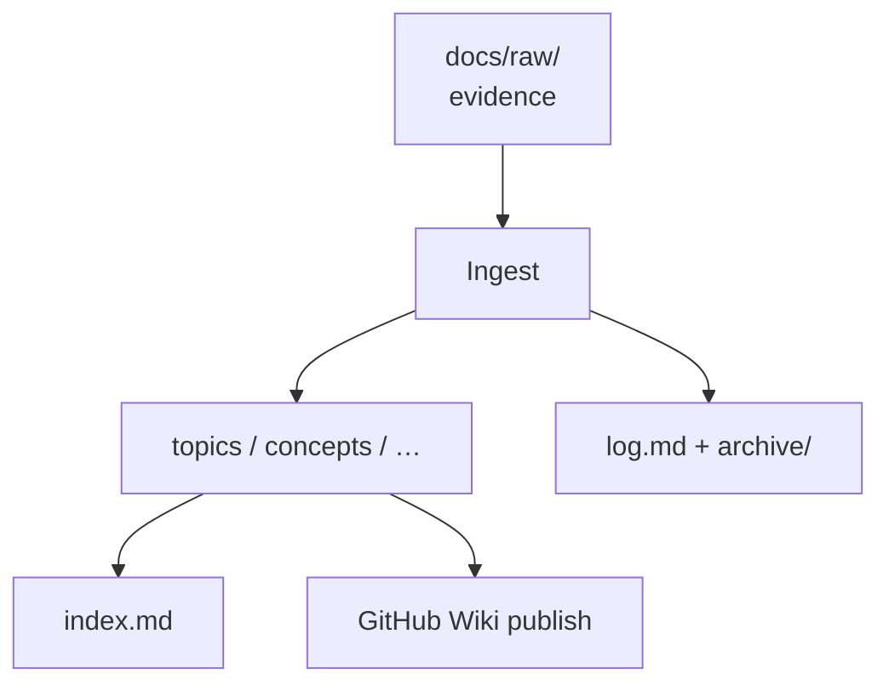

# LLM wiki pattern

**Summary**: A Karpathy-style knowledge base where an LLM maintains interlinked markdown pages from curated raw sources, so answers compound over time.

**Sources**: Template stubs.

**Last updated**: (set on first real ingest)

---

## Why

Chat transcripts are ephemeral. A wiki with an index, citations, and an operation log turns each
investigation into durable memory the next session can reuse.

## Layers

## Related pages

- [[getting-started]]
